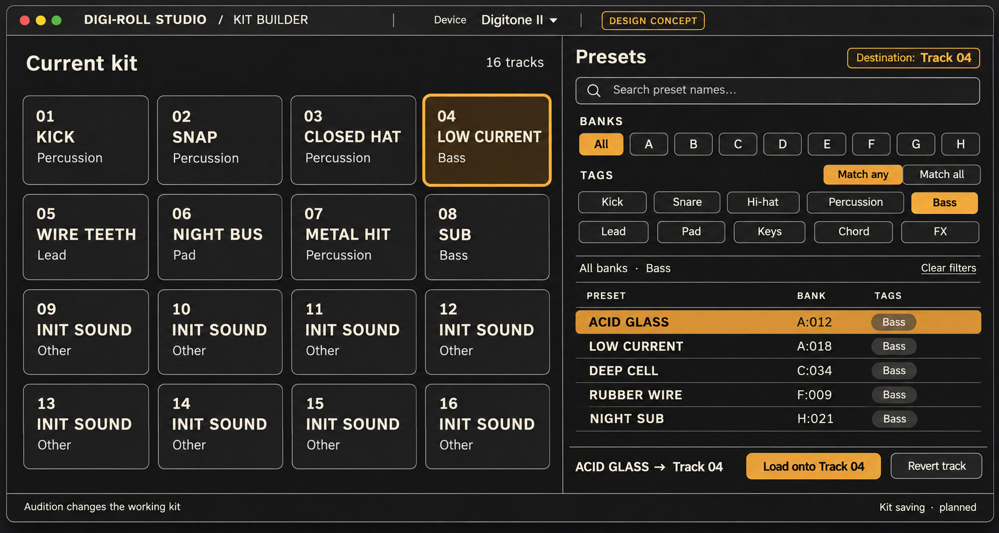

# Kit builder — implementation plan

Status: implemented 2026-11-12; offline visual review completed; hardware acceptance pending.
Design review: 2026-11-11.

Build a track-led kit workspace: choose a track from a grid, find a preset with
text, bank and tag filters, then load it onto that track. Keep the complete kit
visible while browsing. This develops the browse/load feature recorded in
[PLAN.md §10](PLAN.md#10-the-kit-builder-and-the-analog-four-protocol-log),
using its existing device operations rather than introducing another write path.

## Approved direction

The user selected the **Kit grid** concept, then requested the full Elektron
preset discovery controls: tags, text search and bank selectors/filters.
The revised visual was accepted as the implementation direction.

Treat the image as a layout reference, not a literal specification of hardware
data. Names and tag examples are illustrative. Use the application's native
egui controls, typography and theme; retain the grid/browser hierarchy, clear
selection and prominent destination. Do not copy the decorative macOS chrome
or the design-concept badge into the product.

## Scope

First release includes:

- A kit grid beside a full preset browser, replacing/evolving the current
  Presets surface with one shared state owner.
- Text search, All/single-bank selection, multiple tag selection, Match any /
  Match all, filter summary and Clear filters.
- Explicit load onto the selected track and the existing double-click shortcut.
- Per-track revert, plus the existing device-wide revert under an unambiguous
  label such as “Revert auditioned tracks”.
- Cached/offline browsing and the existing listing, tag scan, cancellation,
  progress, compatibility and error states.

Complete-kit saving to +Drive remains a separate phase. No new kit serializer,
multi-chunk write implementation, sample transfer, drag-and-drop assignment,
random kit generation or offline kit-file format is required for this release.
Do not present a working Save kit action. Keep the instruction to save on the
hardware before leaving an unsaved working kit; see PLAN.md §10.5 for the
recorded kit-save limitations, which need fresh verification before that phase.

The proposed DN2-first follow-up is [WP-KIT-SAVE-01](KIT-SAVE-WORK-PACKAGE.md).
It defines the evidence gate, implementation sequence and hardware acceptance
for a future agent handoff; it does not authorize implementation or device writes.

## Layout and interaction

### Device and track grid

- Show the selected device in the header. Keep the destination synchronized
  with the application's selection rather than maintaining a second hidden
  target. Clicking a tile selects it; selecting a track never writes a sound.
- At a wide desktop size, allocate approximately 55–60% to the grid and the
  remainder to the browser. Use four columns for a 16-track device.
- Derive usable destinations from `Device::preset_load()` / `PresetLoad`
  capabilities and the track model, not a hard-coded count. DT2/DN2 can show
  16 tracks; the A4 has four sound destinations. FX/CV and MIDI-only tracks
  must never become loadable just because they have a tile. Unsupported
  devices retain an explicit explanation, not guessed protocol support.
- Each tile shows track number, known sound name, selection and auditioned
  state. Show category/tag information only when it is known; do not infer a
  tag from the sound name or fill unknown tracks with fictional INIT SOUND.
- Distinguish unknown, session/saved-pattern-derived and verified working-state
  sound names. Opening the workspace performs no automatic hardware read.
  Existing fetched names may describe a saved pattern rather than the active
  working kit; the UI must label that provenance.
- Update a tile only after the corresponding load/revert result is verified.
  Capture device and track with each job, so a later selection change cannot
  redirect a completion. Device/pattern changes and reconnects must not leave
  old names presented as freshly verified working-state data.

### Preset browser

Order the right-hand pane as follows:

1. “Presets” heading and explicit destination, e.g. “Track 04”.
2. Preset-name text search.
3. Bank selectors: All plus the available banks, with A–H as the current
   fallback until the device listing supplies its actual banks.
4. Tag chips and Match any / Match all selector.
5. Active filter summary, Clear filters and result count.
6. Results with preset name, bank/slot, tags and compatibility state.
7. Persistent load/revert actions and nearby operation status.

Bank selection is All or one bank in this release; arbitrary bank subsets are
not required by the approved design. Bank, name and tag filters combine with
AND. Name matching remains trimmed and case-insensitive as in the current
browser. Default to All banks, empty search, no selected tags and Match any.

For nonzero selected tag mask `mask`:

- Match any: `(tags & mask) != 0` (existing behavior).
- Match all: `(tags & mask) == mask` (new behavior).
- No selected tags: bypass tag filtering in either mode.

Use the selected model's verified tag table. Keep every tag present in the
indexed bank scope accessible, rather than limiting the UI to the ten example
chips in the image. Retain selected chips even when a bank change makes their
count zero, so the active filter can always be removed. Tag counts describe
indexed presets in the bank scope, not an implied complete device inventory.

Unscanned tags are unknown, not “no tags”. Preserve the current count/explanation
for rows excluded because their tags are unread, and keep READ TAGS available.
Text-only browsing must still work without a tag scan. Keep LIST, READ TAGS,
STOP/resume behavior and scan progress accessible even though the concept
image omits them. Preserve incompatible-format explanations.

Clear filters restores All banks, empty search, no selected tags and Match any;
it does not change the destination or discard audition backups. If filtering
hides the selected preset, clear that result selection and disable Load until
a visible result is selected. Display an actionable empty-results state.

### Load and recovery

- Spell out the destination in the action label (“Load onto Track 04”) and
  name the selected preset next to it. Use supported glyphs; the current font
  has a documented missing-arrow issue, so use “onto” instead of the image's
  arrow unless font coverage is fixed separately.
- Keep current identity, model/build, format, target and busy-state guards,
  read-before-write backup and read-back verification. Do not create MIDI
  operations from rendering or selection/filter changes.
- Capture the first pre-load sound per `(DeviceId, track)` and retain it across
  subsequent auditions and device switches. Revert means return to that sound,
  not undo the last audition. Backups remain session-only, as today; closing
  and reopening this surface must not silently reset them.
- Add selected-track revert by passing only that track's backup to the existing
  revert worker. Preserve explicit all-auditioned-tracks recovery. Never wire
  the label “Revert track” to today's all-track operation.
- A failure must preserve available recovery data, identify its target and
  leave uncertain hardware state visibly uncertain. Partial all-track revert
  must distinguish restored and failed tracks.
- Browsing cached data is available offline; hardware load/revert is disabled
  with a reason. Keep working-buffer consequences and session-only recovery
  visible near the actions.

### Sizing and accessibility

Use a resizable grid/browser split where practical. At narrower sizes, reduce
grid columns and stack regions before controls overlap. Allow results and long
tag collections to scroll while keeping destination and actions discoverable.
Validate the existing supported minimum window size and a typical laptop size.
Provide keyboard access to track selection, search, banks, chips, result
selection and explicit Load/Revert. Selection and audition state need text or
shape cues as well as color. Do not trigger hardware writes from focus alone.

## Implementation map

| Area | Existing source | Planned change |
|---|---|---|
| Workspace integration | `crates/app/src/main.rs`, `crates/app/src/ui/tools.rs` | Evolve the Presets entry into Kit builder; expose enough width and propagate track selection without losing the existing state owner. |
| Browser and jobs | `crates/app/src/ui/presets.rs` | Reuse `PresetsPanel`, `Library`, job polling, selection guards and backups. Extract render helpers or a kit-builder module if needed; avoid parallel browser caches or worker implementations. |
| Filters | `Library::filtered`, `tag_cells`, `View` in `ui/presets.rs` | Add explicit tag-match mode, clear-filter semantics and selected-zero-count chips; retain unknown-tag reporting and offline fallback. |
| Track display | `crates/core/src/model.rs`, existing `PatchSound` / `TrackPatch` data | Build a provenance-aware tile view; supplement with verified per-track operation results without pretending cached data is live. |
| Device capabilities | `crates/core/src/device.rs` | Reuse `PresetLoad` routing and slot limits; do not expand device support as part of UI work. |
| Hardware operations | `crates/midi/src/preset_load.rs`, `a4_preset_load.rs` | Reuse current routes and verification; selected-track revert should only narrow the backup set supplied to the existing worker. |
| Preset metadata | `crates/protocol/src/preset_index.rs`, existing sound tag tables | Reuse index/cache and model-specific tag names; no new cache format unless implementation demonstrates a need. |
| Tests | `crates/app/tests/all/presets.rs` | Extend behavioral coverage for new filtering, destination, state and revert semantics. |

## Delivery sequence

- [x] **1. State and filters.** Add tag-match mode and tests; define grid
  provenance and selection behavior; preserve existing browser tests.
- [x] **2. Grid and browser layout.** Integrate into native app navigation,
  render capability-derived tiles and full discovery controls, and validate
  resizing using cached/fixture data with no hardware attached.
- [x] **3. Actions and recovery.** Connect grid selection to existing load jobs,
  add scoped revert and retain all-track recovery; update verified tile states
  and handle selection changes, failures and disconnects.
- [x] **4. Regression and visual review.** Exercise empty, offline, partially
  indexed, incompatible, loading and failed states; compare the native layout
  against the accepted concept, including a full model tag set.
- [ ] **5. Hardware acceptance.** In a dedicated user-authorized session, verify
  audition and recovery on supported available devices. Record model, OS/build,
  operations, observed results and anything not tested in DEVELOPMENT.md.
  No hardware writes are part of automated tests or this planning task.
- [x] **6. Documentation.** Update README's feature entry and PLAN.md §10 with
  actual shipped behavior and evidence; keep full-kit saving explicitly separate.

## Acceptance checks

- Combined name + bank + multiple-tag filtering works for Any and All, including
  empty masks, zero results, unknown tags and model-specific tag tables.
- Clear filters and filtered-out selection cannot cause a hidden preset load.
- All supported destinations are represented; MIDI/FX/CV/unsupported targets
  are refused correctly. Switching devices cannot reuse another model's tags.
- Selecting tracks, banks and presets makes no hardware writes. Explicit Load
  and double-click capture the same visible device/track/preset target.
- Multiple auditions keep the first backup. Selected-track revert affects only
  its target; all-track revert reports partial failure accurately. Reopening
  the workspace and switching devices preserve recovery data.
- Jobs finishing after a selection/device change update their original target,
  never the new selection. Disconnects and stale cached names remain honest.
- Existing list/scan cancellation, resume, format refusal and verified load
  tests continue to pass. No new protocol support is implied by the UI.
- The native screen remains usable with all discovered tags, long names and
  scan/error messages at laptop and minimum supported window sizes.

For implementation, run the relevant app tests first
(`cargo test -p digi_roll_studio --test all`), then the documented pre-commit
workspace tests and clippy checks, plus formatting checks for changed Rust.
Visual review and hardware acceptance are separate evidence; unit tests alone
must not be described as proof of hardware behavior.

## Implementation evidence — 2026-11-12

The Presets state owner now renders Kit builder (`K`), with a bounded wider
workspace, a 56/44 grid/browser layout and a stacked narrow layout. The split
ratio is fixed in this release; the regions adapt to window width. Track names
are explicitly session/saved-pattern or last-operation observations, never an
assertion about the current hardware buffer. No opening read is performed.

Recovery bytes are published from both existing load routes before a write can
occur, so failed verification retains the first backup. Selected-track recovery
narrows the existing worker input; successful partial recovery removes only
restored backups. The new tests cover these rules without MIDI hardware.

The offline native preview (`cargo run -p digi_roll_studio --example
kit_builder_preview`) uses synthetic cache data and no MIDI ports or engine.
Reviewed at 1100×760 and 640×700 with all 32 model tags, DN2/A4 switching,
track selection, tag filtering and the A4 non-sound destination refusal.
Headless frames also exercise a 330px workspace. Hardware acceptance, real
long-running scans and real-device load/revert are not claimed by this review.

Validation completed: `cargo test --workspace -q` passed all 2,252 tests;
`cargo clippy --workspace --all-targets -- -D warnings` passed; `rustfmt --check`
passed for all changed Rust files, and `git diff --check` passed.
